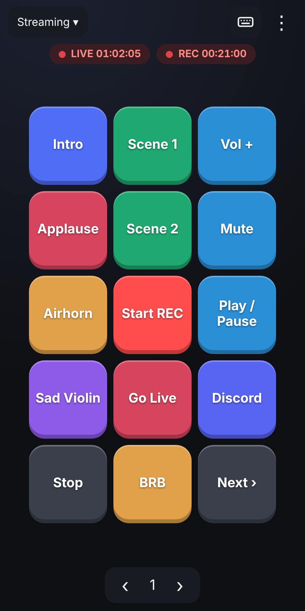
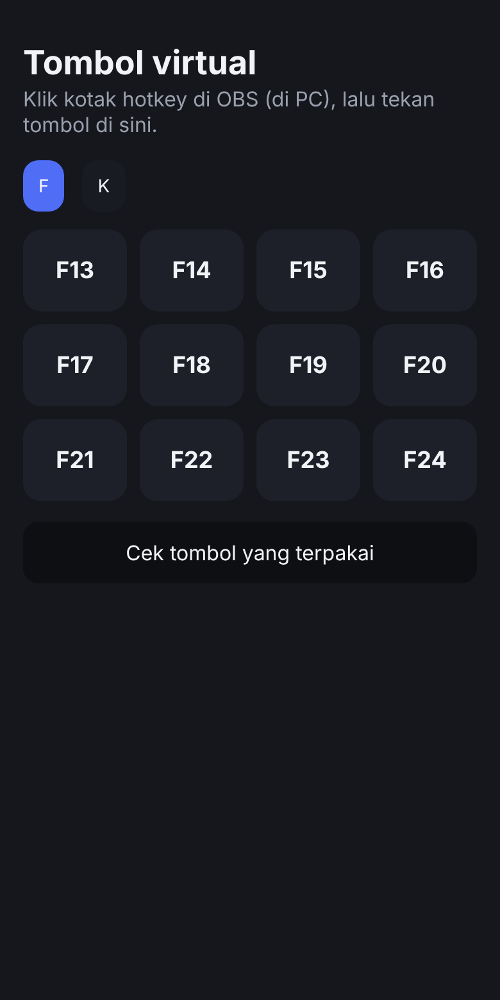
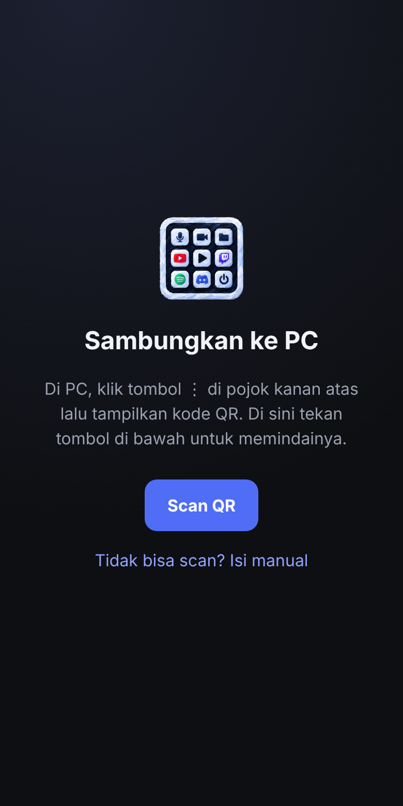
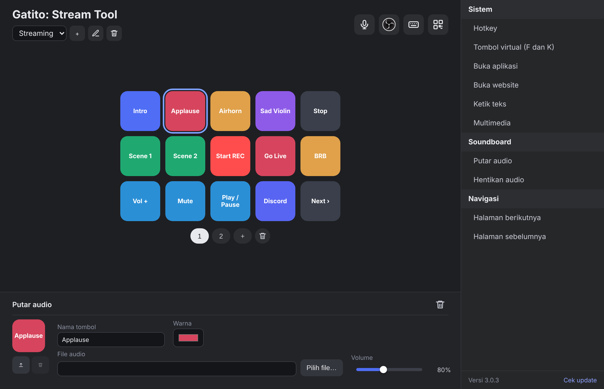

<div align="center">



<br>

### Ubah HP-mu jadi **panel kontrol streaming** yang bisa kamu tekan, tanpa beli Stream Deck.

Mainkan efek suara ke Discord, ganti scene OBS, mulai rekaman, dan pantau durasi LIVE,
semua dari satu layar sentuh di tanganmu.

<br>


</div>

---

## Kenapa kamu bakal suka Gatito

Stream Deck asli harganya jutaan rupiah, padahal HP yang nganggur di meja sudah punya layar sentuh,
WiFi, dan getar. **Gatito** memanfaatkan itu. Pasang aplikasinya di PC dan HP, scan satu kode QR,
dan HP-mu langsung berubah jadi deretan tombol warna-warni yang bisa melakukan hampir apa saja di PC.

<table>
<tr>
<td width="50%" valign="top">

### 🎛️ Satu tap, langsung jalan
Tombol bisa menekan hotkey, mengetik teks otomatis, membuka aplikasi atau website,
mengatur volume, sampai memutar efek suara. Kamu yang atur isinya.

</td>
<td width="50%" valign="top">

### 🔊 Soundboard yang didengar temanmu
Suara dari tombol dicampur dengan mic aslimu lalu dikirim ke Discord, Roblox, atau game apa pun
lewat mic virtual. Teman ikut dengar, dan kamu tetap dengar lewat headset.

</td>
</tr>
<tr>
<td width="50%" valign="top">

### 🔴 Status OBS di genggaman
Tombol LIVE dan REC di HP menyala merah lengkap dengan timer yang berjalan,
jadi kamu tahu stream-mu aman tanpa melirik monitor.

</td>
<td width="50%" valign="top">

### 📶 Tanpa kabel, tanpa ribet
Scan QR sekali, selesai. HP dan PC cukup satu WiFi. Tidak ada akun, tidak ada cloud,
tidak ada langganan. Semua jalan di jaringan rumahmu sendiri.

</td>
</tr>
</table>

---

## Lihat langsung

<div align="center">


&nbsp;&nbsp;

&nbsp;&nbsp;


<sub><b>Deck di HP</b> (lengkap dengan LIVE dan REC) · <b>Tombol virtual F13–F24</b> · <b>Layar sambung ke PC</b></sub>

<br><br>



<sub><b>Editor di PC.</b> Klik tombol, atur isinya, atau seret aksi dari daftar di kanan.</sub>

<br><br>

<sub>Screenshot dirender dari antarmuka web (<code>phone.html</code> dan <code>editor.html</code>) dengan data contoh.
Aplikasi native mengikuti tata letak yang sama.</sub>

</div>

---

## Apa saja yang bisa dilakukan satu tombol?

| Kelompok | Aksi | Contoh pemakaian |
|---|---|---|
| **Sistem** | Hotkey | `Ctrl+Shift+M` untuk mute di aplikasi lain |
| | Tombol virtual (F13–F24, K1–K36) | Tombol rahasia yang tidak bentrok dengan apa pun, cocok untuk hotkey OBS |
| | Buka aplikasi | Daftar dari Start Menu, lengkap dengan ikonnya |
| | Buka website | Ketik `youtube.com`, `https://` ditambahkan otomatis |
| | Ketik teks | Kirim "GG, makasih udah mampir!" ke chat dengan satu tap |
| | Multimedia | Volume naik/turun, mute, play/pause, lagu berikutnya/sebelumnya |
| **Soundboard** | Putar audio | mp3, wav, ogg, m4a, aac, flac. Volume tiap tombol bisa 0 sampai 200% |
| | Hentikan audio | Stop semua suara yang sedang jalan |
| **Navigasi** | Halaman berikutnya / sebelumnya | Satu profil bisa punya banyak halaman |

**Bikin tampilannya sendiri:** grid bisa diatur (bawaan 5×3), banyak **profil** (Streaming, Gaming, Podcast),
banyak **halaman** per profil, warna bebas, dan tombol bisa berisi **gambar atau GIF** (GIF maksimal 6 MB)
dengan efek **CRT** retro kalau mau.

---

## Cara kerjanya

```
 ┌──────────────┐     WiFi yang sama      ┌───────────────────────────────┐
 │   HP kamu    │  ◄──────────────────►   │            PC kamu            │
 │   Android    │   HTTP + WebSocket      │                               │
 │              │                         │  Server lokal (Rust)          │
 │  Tap tombol ─┼──── "tombol #7" ───────►│    ├─ Input   → hotkey, teks  │
 │              │                         │    ├─ Audio   → mic virtual   │
 │  Lihat LIVE ◄┼──── status OBS ◄────────│    └─ OBS     → obs-websocket │
 └──────────────┘                         └───────────────────────────────┘
```

1. **Pasang** Gatito di PC (installer `.exe`) dan di HP (`.apk`).
2. **Sambungkan.** Di PC buka tombol QR, di HP tekan **Scan QR**. Gatito memakai kode 6 angka sekali pakai,
   lalu HP mendapat token pribadi supaya tidak perlu scan lagi. Kamera bermasalah? Ada isi manual.
3. **Atur tombol** di editor PC. Perubahan langsung muncul di HP.
4. **Tap.** HP mengirim nomor tombol ke PC lewat WebSocket, PC yang menjalankan aksinya
   (menekan hotkey, memutar suara, membuka aplikasi, dan seterusnya). HP bergetar sebagai tanda tombol terkirim.

### Bagian suara (soundboard)

Cara kerjanya mirip Soundpad:

1. Suara tombol **dicampur dengan mic aslimu**, lalu dikirim ke kabel virtual (**VB-Cable**).
2. Discord atau game memakai ujung satunya sebagai mikrofon, jadi temanmu ikut mendengar.
3. Suara yang sama juga diputar ke headset atau speaker pilihanmu, supaya kamu tetap mendengarnya.

Tidak mau memasang VB-Cable manual? Gatito bisa **mengunduh dan memasangnya otomatis** dengan satu kali izin
administrator, memilih mic virtual sebagai default, lalu mengembalikan speaker default seperti semula.
Skrip yang dijalankan dicek hash SHA-256 dulu supaya tidak bisa diganti di tengah jalan.

### Bagian OBS

Aktifkan **WebSocket Server** di OBS (Tools → WebSocket Server Settings, OBS 28 ke atas), isi host, port
(bawaan 4455) dan password di Gatito. Setelah itu HP menampilkan **LIVE** dan **REC** beserta lamanya,
termasuk status *jeda* dan *putus sambung*.

---

## Dibuat pakai apa

<table>
<tr>
<th width="50%">💻 PC · Rust</th>
<th width="50%">📱 HP · Kotlin</th>
</tr>
<tr>
<td valign="top">

- **eframe / egui** untuk jendela editor native (tanpa WebView)
- **axum + tokio** untuk server HTTP dan WebSocket
- **cpal + symphonia** untuk mesin suara (decode, mixing, output)
- **tokio-tungstenite** untuk menghubungi obs-websocket v5
- **tray-icon** untuk ikon di system tray
- **qrcode** untuk membuat kode QR sambungan
- **reqwest (rustls)** untuk cek update dan unduh VB-Cable
- **windows crate** untuk mengirim tombol keyboard
- **NSIS** untuk installer `.exe`

</td>
<td valign="top">

- **Jetpack Compose + Material 3** untuk seluruh tampilan (tanpa WebView)
- **CameraX + ZXing** untuk memindai QR
- **OkHttp** untuk WebSocket dan HTTP
- **Coil (+ GIF)** untuk gambar dan GIF di tombol
- **ViewModel + Coroutines** untuk state dan koneksi
- Minimal **Android 7.0** (API 24)
- Pembaruan aplikasi langsung dari dalam aplikasi

</td>
</tr>
</table>

---

## Hal kecil yang bikin nyaman

- 🔔 **Satu instance saja.** Membuka Gatito kedua cukup memunculkan jendela yang pertama.
- 🔌 **Port otomatis berpindah** kalau `3000` dipakai program lain, dan bisa diatur manual.
- 🔄 **Update dari GitHub.** Aplikasi mengecek rilis terbaru, memeriksa ukuran dan hash, lalu memasangnya.
- 📵 **Layar HP tetap menyala** selama aplikasi terbuka, dengan pilihan mati otomatis 1 sampai 30 menit.
- 🔙 **Reconnect sendiri** kalau WiFi sempat putus, dan layar "PC tidak terhubung" muncul kalau memang mati.
- 🌐 **Halaman web cadangan.** HP tanpa aplikasi tetap bisa membuka alamat PC lewat browser.

---

## Struktur proyek

```
pc/        Rust: server, mesin suara, OBS, VB-Cable, update, tray, GUI egui
android/   Kotlin + Jetpack Compose: aplikasi HP dan pemindai QR
.github/   build.yml: membuat installer .exe dan .apk otomatis
```

| Mau lihat... | Buka |
|---|---|
| Editor dan semua dialog | `pc/src/gui/` |
| Server HTTP dan WebSocket | `pc/src/server.rs` |
| Aksi tombol (hotkey, teks, media) | `pc/src/input.rs` |
| Mesin suara | `pc/src/audio.rs`, `pc/src/winaudio.rs` |
| Sambungan OBS | `pc/src/obs.rs` |
| Tampilan HP | `android/app/src/main/java/com/streamdeckhp/app/Ui.kt` |

---

## Mulai build sendiri

**PC (Windows)**
```bash
cd pc
cargo build --release
makensis /DVERSION=3.0.3 installer.nsi   # opsional: bikin installer
```

**Android** (butuh JDK 17 dan Android SDK)
```bash
cd android
bash build-apk.sh
```

**Lewat GitHub:** upload semua isi folder ini, lalu workflow `build.yml` menghasilkan `.exe` dan `.apk`.
Isi secrets `KEYSTORE_B64` dan `KEYSTORE_PASSWORD` kalau mau APK-nya menimpa versi lama
(alias `streamdeckhp`, `applicationId` `com.streamdeckhp.app`).

> ⚠️ **Status:** kode ini ditulis ulang dari versi Electron + Capacitor (v2.6.1) dan **belum pernah dikompilasi**.
> Kemungkinan ada error build kecil (misalnya nama API egui/eframe 0.29 atau versi crate), dan tampilan perlu disetel
> sedikit karena egui dan Compose menggambar berbeda dari browser. Kirim log error-nya dan kita rapikan bersama.

---

<div align="center">

**Gatito: Stream Tool** · dibuat untuk streamer yang maunya praktis 🐱

</div>
